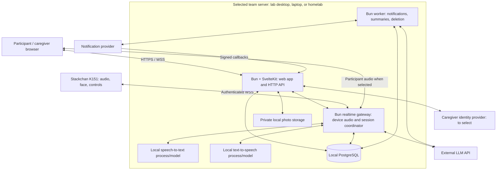

# Lemmi — Technical specification

**Status:** Draft for team review  
**Version:** 0.4  
**Scope:** Hackathon prototype; fictional participant data and opted-in team notification recipients

This document proposes implementation contracts for the [product](product-spec.md), [experience](experience-spec.md), and [safety and privacy](safety-and-privacy.md) specifications. A local mock application foundation exists; its actual files/status and commands are in [team-start.md](team-start.md). No firmware or live service integration is implemented. Technology selections and numeric limits below are proposed defaults; provider selection and hardware feasibility remain open. Safety and privacy rules apply across every interface.

## 1. Architecture and deployment

Stackchan is the preferred participant interface. One shared backend coordinates conversation, activities, and journal data. A separate background worker handles durable caregiver notifications. Both backend and worker belong to the same codebase and use the same database; this is not a microservice project.



Deployment direction: run the SvelteKit backend/web app, realtime gateway, worker, PostgreSQL, private photo storage, and local STT/TTS processes on one selected team-managed machine. The LLM remains an external API; notification delivery and any selected managed identity provider also remain network dependencies. This is self-hosted application/speech processing, not a fully offline system. The ESP32 performs audio I/O, display, and local controls, not STT/TTS model inference.

### Candidate server machines

| Candidate | Role and reported advantages | Required verification |
| --- | --- | --- |
| Lab desktop | Preferred candidate to evaluate first; teammate reports Ethernet and a GPU. | Availability/permission to install and keep services running, exact GPU/driver compatibility, model memory, campus-to-demo connectivity, and measured end-to-end response time. |
| Team laptop | Portable fallback that can be at the demo venue. | Adequate memory/compute for the selected models, power, disabled sleep, reachable app/gateway, and tested database/photo migration. |
| Teammate homelab | Alternative server if accessible from the venue. | Stable power/network, authenticated remote access, sufficient compute, and measured campus-to-homelab network latency. It may be physically remote rather than on the same LAN. |

Ethernet/GPU advantages are team-reported and unbenchmarked. Do not claim the lab desktop has the lowest total latency merely because it is on Ethernet or assume being on campus guarantees device reachability. Select the host after actual network/audio tests, and prepare a laptop fallback before the presentation.

The server can be administered over authorized SSH or VNC if needed; normal participant/caregiver use remains through the robot/browser. A server display is not required by the proposed services. Keep SSH/VNC behind appropriate authenticated access, outside the public application tunnel, and do not use remote desktop access as a substitute for the app or authenticated caregiver acknowledgment.

Use an approved HTTPS/WSS reverse proxy or tunnel for robot/browser access and provider callbacks when campus routing prevents direct access. The robot initiates outbound connections. Verify connectivity from the actual demo network and from the caregiver's second device, including any off-campus/cellular path used in the demo. No unauthenticated database, model, SSH, or VNC port should be exposed. Closing the browser or remote-administration session must not stop backend/worker processes; server sleep, power loss, firewall rules, or lost connectivity still can.

### Proposed stack

| Layer | Default proposal | Boundary |
| --- | --- | --- |
| Web app | SvelteKit + Svelte + TypeScript, built/run with Bun | Caregiver setup/journal/inbox and complete participant fallback; browser microphone permission required only for app voice. |
| Backend HTTP API | Bun + SvelteKit server routes/actions + TypeScript | SvelteKit owns `/v1` business HTTP routes; server-only domain code is shared with worker/gateway. No Fastify or duplicate standalone HTTP business API. |
| Realtime transport | Small native `Bun.serve` WebSocket gateway | Owns active audio/session coordination and device connections; delegates durable domain operations to shared server code. |
| Background work | Bun worker with a PostgreSQL job/outbox table | Durable notification scheduling; summaries and deletion are lower-priority jobs. No in-browser or in-memory-only escalation timers. |
| Database/photos | PostgreSQL and private photo files on the selected server | Persistent local volumes, explicit ownership checks, restricted OS/database access, and deletion; no managed cloud database is the default. |
| Authentication | Minimal caregiver sign-in; identity provider/library to select | Identity hosting is separate from the now-local database decision. Remove any assumption that Supabase database/storage is required. |
| STT/TTS | Local model processes alongside the backend | Pin model/runtime/voice versions after benchmarking. Loopback-only endpoints or local IPC; no silent external speech fallback. |
| LLM | External API through a server-side adapter | Send minimum permitted text context, not raw microphone audio. Keep keys server-side and document provider retention. |
| Notifications | Provider adapter; Twilio SMS is a candidate | Prove opted-in team delivery early; account/sender readiness must be checked. Email or push can be selected if actually tested. |
| Robot | K151-compatible C++ firmware using supported M5Stack tooling | Adapt existing firmware or build a focused client after examining the installed version. |

The database and photo store are now self-hosted. Caregiver authentication remains required; the implementation choice can be managed identity or a maintained authentication library, but must work with the local data ownership model. Twilio remains a notification candidate with documented [message-status callbacks](https://www.twilio.com/docs/messaging/guides/track-outbound-message-status); acknowledgment is implemented by Lemmi.

### Local speech services

Anay owns local recognition/synthesis selection and integration; Emilia owns robot audio I/O and transport. Candidates to benchmark include [whisper.cpp](https://github.com/ggml-org/whisper.cpp) for STT and [Piper](https://github.com/OHF-Voice/piper1-gpl) for TTS; neither engine, model size, voice, accelerator, nor performance is selected by this document. Check engine and chosen model/voice licenses, platform support, quality, memory/VRAM, and ability to cancel work. Use existing maintained engines rather than reimplementing model inference in Bun or on the ESP32. Local model runtimes may use their own C++/Python tooling while Lemmi remains Bun + SvelteKit.

Run speech inference as bounded local processes/services, keep models warm, and finish model downloads before the demo. Bind inference endpoints to loopback or authenticated private IPC; never expose them through the public app proxy. Select an in-memory audio path and inspect engine defaults for recordings, temporary audio, debug transcripts, and caches. Disable those writes; a service that requires persistent raw audio does not meet the current privacy specification.

Flow: robot/browser audio → local STT → minimum text context to external LLM → checked response text → local TTS → robot/browser playback. Send approved text segments for synthesis and stream resulting audio when supported. Keep the existing turn-ending, cancellation, and privacy rules. Local speech does not remove the 4-second draft end-of-turn wait or external LLM/network delay.

Benchmark at least 20 fictional turns on the selected machine and actual demo network. Record typical and slow end-to-end times, recognition completion, LLM wait, TTS first audio, playback gaps, false turn endings, local stop, and CPU/RAM/VRAM load. Warm-start and cold-start results are separate. A proposed goal is usually 2–3 seconds to first speech after explicit turn-end, not a measured result or guarantee. Validate simultaneous display, networking, and audio on K151. Prepare the same selected models on the laptop fallback and remeasure; do not assume the lab GPU model fits or runs equally fast there.

### SvelteKit and Bun integration

Use SvelteKit for pages, caregiver session handling, server actions, and the existing `/v1` business HTTP routes. Domain code belongs in server-only modules/shared packages, not browser components. SvelteKit handlers authenticate and validate, then call those modules; worker/gateway code uses the same rules rather than implementing parallel profile/contact/journal APIs.

The official [SvelteKit Bun adapter](https://svelte.dev/docs/kit/adapter-bun) requires Bun 1.4 or newer and does not expose WebSocket configuration through generated server options. Keep the robot/audio WebSocket connection in a small [native Bun gateway](https://bun.sh/docs/runtime/http/websockets), part of the same application/codebase. The gateway owns the single active session coordinator; SvelteKit HTTP session commands reach it through an authenticated loopback interface. Restrict that internal interface to typed session commands, not a second public business API. Persistent contact requests and worker jobs remain independent of gateway availability. If the coordinator is down, report session unavailability while allowing HTTP caregiver/help operations that do not depend on it.

Expose one HTTPS/WSS origin: SvelteKit handles pages and `/v1` HTTP routes; the reverse proxy routes WebSocket upgrade requests for `/v1/device-stream` and the agreed participant event/audio stream to the Bun gateway. Local STT/TTS and PostgreSQL are not public routes. Test production builds, gateway upgrades, SDK/model-process integrations, and worker restart under pinned Bun/tool versions. Use Bun installation/scripts and the agreed lockfile; type checking remains explicit. Server authorization, cookie scope, trusted origins, callback signatures, and rate limiting apply to every exposed route.

### Named implementation and contract ownership

Anay owns SvelteKit backend HTTP routes, Bun realtime/session gateway, local STT/TTS, external LLM, PostgreSQL/private media, auth/contact/journal/summary worker, and server deployment. Emilia owns the K151 WSS client, audio capture/playback, local mute/unmute/stop/watchdog, and mascot rendering. Kylie owns all app screens/design/art/browser audio, including caregiver journal/contact/profile views. Lukas owns pure activity logic/content and demo coordination. Anay publishes schemas/mocks first; see [integration contracts](integration-contracts.md) for actual proposed interfaces and file boundaries.

The robot connects to the backend gateway; “connect to app” means participating in the same session the SvelteKit UI displays, not depending on a browser tab as its server. Emilia and Anay agree wire samples before implementation. Kylie renders Lukas's ActivityView rather than copying rules; Anay hosts Lukas's engine rather than writing another activity system.

## 2. Stackchan hardware and firmware boundary

The identified hardware is M5Stack StackChan K151. Manufacturer documentation lists an ESP32-S3, Wi-Fi, dual microphones, speaker, a 2-inch 320 × 240 touch display, a three-zone touch panel, and two servos. Arduino, PlatformIO, and ESP-IDF are documented development options. This establishes hardware availability, not installed firmware capabilities. [M5Stack documentation](https://docs.m5stack.com/en/StackChan)

### Firmware responsibilities

- Audio capture/playback, bounded RAM buffers, visible microphone state, and local interruption.
- Render the explicitly selected dog/cat/bunny/bird/lemming avatar and separate interaction-state expression; use the integration contract’s avatar IDs and versioned asset manifest. Render a small set of state labels. Support reduced motion and controlled output volume.
- Report start, pause, stop, help, and activity inputs as typed events.
- Apply local mute/stop immediately, even if the backend is unreachable. Network reporting follows local action, never precedes it.
- Enforce a local connection watchdog and begin every boot/reconnect with capture/output off.
- Accept only bounded expression presets; no arbitrary model-provided motor positions, scripts, or firmware updates.
- Keep camera off except during a valid F13 check-in; NFC, background listening, audio/video recording and unused remote-control features remain disabled. Implement F13 before F14 petting/motion/status/health enhancements; see the robot capability spec.

The exact control mapping is unresolved. Prototype a persistent touchscreen stop target and accessible start/pause/help controls; evaluate the touch zones as additional inputs. If these cannot be made usable, use app-assisted controls or a separately evaluated external button. Do not describe a touch zone as a physical microphone disconnect or assume factory power/reset buttons provide the required interaction controls.

First establish pairing, immediate local stop and readable indicators; test the official camera example early. Prove F13 request/Allow/stream/Stop through the shared gateway before F14 reaction polish. In parallel, the first audio milestone remains microphone → backend → spoken response, local interruption, connection-loss stop, and a direct help event. Then test photo album and guessing views separately for readability and input usability. App-assisted activities may use the robot for speech and a larger screen for choices without creating another session.

### Alternative connection

If direct firmware integration is impractical, an optional local bridge can connect supported robot interfaces to the same backend protocol. It must preserve local stop/watchdog behavior and be documented as required hardware. USB audio/control support must be verified, not assumed. If neither route works, demonstrate the standalone app and record the unmet robot target.

## 3. Components and authority

| Component | Owns | Cannot do |
| --- | --- | --- |
| Session coordinator | Session/turn state, active audio endpoint, cancellation, activity handoff | Override a local mute or resume automatically after reconnect. |
| Conversation service | Approved-context selection, speech/model adapters, response checks | Rewrite biography, choose contacts, perform medical assessment, or move hardware. |
| Activity engine | Versioned built-in packs, deterministic choices/hints/progression | Infer decline or run executable third-party packs. |
| Profile service | Caregiver-provided facts, source labels, revision control | Promote conversation statements automatically. |
| Journal service | Permitted events/excerpts, observations, summary review | Persist disallowed utterance content or diagnostic interpretations. |
| Contact service/worker | Verified routing, sends, receipts, acknowledgment, escalation | Treat delivery as human response or guarantee emergency help. |
| Robot/browser client | Local controls and actual capture/output state | Change destinations, access caregiver records, or hold provider keys. |

The backend is the shared application authority; local clients may always move to a more restrictive stopped/muted state. Profile edits and session-state changes are versioned. Contact-request state is independent of conversation state.

### Activity engine and media integration

Built-in IDs are `music_playlist`, `twenty_questions`, `photo_album`, `object_matching`; matching is a new explicit requirement and sorting remains superseded. Lukas implements pure create/reduce/project functions with reviewed content and allowlisted effects. Anay's gateway/session coordinator owns the single authoritative activity instance and serializes/deduplicates commands. Kylie renders safe projected views and submits typed actions. See [integration contracts](integration-contracts.md) for ActivityCommand/View, error codes, route extensions, events, and mock fixtures.

Effects request approved speech, track playback, listening, or existing photo conversation; Anay validates generation/privacy/lease/asset scope before execution. No direct network/DB/LLM calls in reducers and no arbitrary URLs or motor commands. Photo changes invalidate speech tied to the old photo. Bounded guessing uses a reviewed question tree first, not unconstrained model instructions or private biography.

Add private approved music assets and album membership/captions to local media metadata. Static permitted music is distinct from transient microphone/generated-speech audio. One output lease controls speech and music: explicit pause/stop/help/handoff silences/invalidates both; music never overlaps capture or TTS. Mic unmute only clears mute and still requires a valid listening action/state. Local stop on the robot flushes both outputs before network acknowledgment. App playback requires user activation and truthful playback/error receipts. Unsupported robot media requires an explicit app speaker handoff, not duplicate playback.

## 4. Conversation and session flow

1. An authenticated device reports capabilities and receives its assigned fictional profile reference. It does not receive caregiver contact destinations or sensitive caregiver notes.
2. An explicit start creates a session with excerpt saving off by default. The backend grants one endpoint an audio lease.
3. During listening, the active client streams audio to the local STT adapter. The indicator reflects actual capture, not a generated phrase.
4. A transcript enters transient memory. Recognized stop/refusal is handled before ordinary conversation. Recognized help enters fixed routing; recognized urgent concerns use the preauthorized policy and prewritten response. Detection can miss or misinterpret speech; the manual help control bypasses these services.
5. For an ordinary turn, assemble application policy, minimum relevant caregiver-provided fields, activity context, and a bounded recent conversation window.
6. Request structured output: `text` and an optional allowlisted proposal such as `offer_photo_album`, `offer_music`, or `offer_twenty_questions`. Treat it as untrusted. Validate schema/action, reject unsupported factual assertions where detectable, and apply the safety specification's reviewed response handling. A prompt or validator does not guarantee safety.
7. Send checked text to the local TTS adapter, display matching text in the app, and stream audio to the current endpoint. No unchecked text/audio is played. If streaming model output is used later, validate complete segments before speech generation.
8. After speech, Quiet returns to capture-off waiting. Conversational/Guided may transition into the next listening turn only with a fresh explicit server capture grant and the same valid session generation, device lease, permissions and local state. Playback completion alone never authorizes capture; unmute requires a fresh explicit speaking action.

Initial context default: at most six recent participant/Lemmi exchanges and a selected profile excerpt, bounded by the chosen model's input limit. Do not persist full conversation or create hidden transcript memory. F15 adds explicitly permitted structured preferences/item policy under the personalization spec; it is not a transcript store. Start a new session without a prior raw transcript, loading only permitted profile-specific policy. Journal events and reviewed facts remain separate.

### Session states and cancellation

States: `ready`, `listening`, `processing`, `speaking`, `waiting`, `paused`, `unavailable`, `ended`. Activities also track their current item/view. Use the experience specification for visible wording and transition controls.

Each turn carries `session_id`, `turn_id`, `generation`, `profile_revision`, `privacy_revision`, and `audio_lease_id`. Pause, stop, profile/privacy changes, endpoint handoff, and disconnect invalidate outstanding turns. Abort provider work where supported, and independently discard stale results before playback or persistence even if provider cancellation fails.

Local Stop flushes playback/capture buffers and invalidates playback permission immediately before reporting to the backend. Mic mute stops capture/transmission, flushes unsent capture and cancels the affected input turn and its pending response; it does not stop unrelated approved speech/music or affect camera state. Unmute never opens capture. Use separate input-turn/output validity and the complete control table in integration-contracts section 5. Stale server messages cannot re-enable capture. On reconnect reconcile into `paused` or `ended`, never replay old audio. Resume returns to ready and needs an explicit speaking action as described in the experience specification.

Contact jobs already created survive conversation stop. Canceling further notification attempts is a separate request action. Ending conversation clears transient dialogue; any already-permitted excerpt writes must have completed before ending or be discarded. End-of-session summary jobs use retained sources only.

## 5. Device and browser protocol

Proposed endpoint: `wss://<api-origin>/v1/device-stream`. A separate authenticated web stream exposes only events the signed-in user or scoped participant client may access. HTTP and WebSocket authorization must bind every resource to its caregiver ownership or device assignment; IDs alone confer no access.

JSON control envelopes use this shape:

```json
{
  "protocol_version": 1,
  "event_id": "uuid",
  "type": "input.help",
  "session_id": "uuid-or-null",
  "turn_id": null,
  "generation": 3,
  "sequence": 12,
  "payload": { "trigger": "manual" }
}
```

The authenticated connection supplies device identity; never trust a claimed device/profile ID by itself. Server timestamps determine retry deadlines; client timestamps, when supplied, are diagnostic only. A help event may have no session ID and still be accepted from a paired device.

| Direction | Event types | Contract |
| --- | --- | --- |
| Client → server | `device.hello`, `heartbeat` | Firmware/protocol version, capabilities, capture/mute state; no biography. |
| Client → server | `input.start`, `input.pause`, `input.stop`, `input.resume`, `input.speak`, `input.turn_end` | Typed input only; local stop/pause already takes effect before transport. |
| Client → server | `input.help`, `activity.command` | Fixed help routing or the validated versioned ActivityCommand from integration contracts; no arbitrary tool execution. |
| Both | `audio.chunk`, `audio.end` | Authorized stream/turn/lease; sequence and encoding checked. |
| Server → client | `state.changed`, `response.text`, `expression.set`, `activity.view` | Current generation only; expressions and views are allowlisted. |
| Server → client | `help.status`, `command.ack`, `error` | Structured status/error codes; contact status text is rendered from templates, not generated by the LLM. |

Start with JSON audio chunks containing base64 PCM plus `stream_id`, sequence, and turn/lease metadata. Proposed wire audio: signed 16-bit little-endian PCM, 16 kHz, mono, 20 ms frames (640 bytes before base64). Negotiate support during hello; resample browser/provider formats in the appropriate adapter. This is a target to benchmark on K151, not an assertion about native microphone output. Binary transport or compression can replace it if profiling justifies the change.

Bound client queued audio to one second and total server in-flight audio per turn; stream to recognition instead of accumulating an entire recording. On sustained backpressure, stop capture, drop unsent audio, invalidate the turn, and show retry. Do not write audio to disk or upload a reconnect backlog. Long utterances must not grow buffers unbounded; provider limits produce a clear retry rather than silent truncation.

Prioritize stop/help control messages over audio processing in bounded queues. Deduplicate control events by connection/event ID, acknowledge applied commands, reject unsupported versions and oversized/invalid frames, and validate sequence order. A shared connection does not provide offline delivery; use HTTPS help submission as an app fallback only when the API remains reachable.

### Draft timing targets

| Setting | Initial target | Failure action |
| --- | --- | --- |
| Local pause/stop | Within 250 ms in rehearsal | Fix local handling or disable independent robot mode. |
| Heartbeat interval / local watchdog | Every 2 s / 6 s since valid heartbeat | Stop capture/output locally; backend pauses session and invalidates its lease. |
| Initial listening silence | 15 s | Waiting state, one invitation, no prompt loop. |
| End-of-turn silence | 4 s after detected speech | Finish turn; use explicit turn-end if service timing cannot support it. |
| Conversation wait | 20 s from turn submission to first playable response | Cancel turn, suppress late output, offer retry. |
| Notification send timeout | 15 s per attempt | Reconcile uncertain outcome; one bounded transient retry. |
| Backup / no-response deadline | 60 s / 120 s from help creation | Backup attempt / no-response status; no automatic send after expiry. |

These are prototype acceptance targets, not clinical response guarantees. Cached status wording and local controls work when AI services fail; remote contact still requires a working communication route.

## 6. HTTP API contracts

All routes are under `/v1`. Browser caregiver mutations require authenticated, authorized access and protection against cross-site request forgery where cookies are used. Paired device/participant credentials are narrowly scoped and cannot administer contacts or read journals. Validate request bodies with shared schemas. Return stable error codes without echoing sensitive request content.

| Method / route | Purpose and key constraints |
| --- | --- |
| `POST /profiles`, `GET /profiles/:id` | Create/read an authorized fictional profile. Return participant-safe projection to participant clients. |
| `PATCH /profiles/:id` | Caregiver edit with `expected_revision`; conflict returns `409` and does not overwrite newer facts. |
| `POST /profiles/:id/photos` | Validated image upload to private storage; approved caption/context and album membership stored separately. |
| Activity/media routes | `/activity-packs`, session activity create/view/action routes, and scoped `/assets/:id` are defined in the integration contracts; SvelteKit owns HTTP handlers, the shared coordinator owns transitions. |
| `DELETE /profiles/:id` | Immediately revoke use and start deletion; return a deletion-job reference, not a premature success claim. |
| `POST /profiles/:id/sessions` | Explicit start; selected endpoint and excerpt permission. Only one active session per profile for this build. |
| `POST /sessions/:id/commands` | Pause/resume/stop/handoff with expected generation and idempotency key. |
| `PATCH /sessions/:id/privacy` | Change excerpt permission, increment revision, clear unsaved queues; remove retained excerpts/dependents when requested. |
| `GET /profiles/:id/journal`, `GET /sessions/:id/journal` | Authorized factual events, excerpts, observations, and source-linked summary. |
| `PATCH /summaries/:id`, `DELETE /summaries/:id` | Review/edit/remove with revision checks and preserved AI origin. |
| `POST /sessions/:id/observations` | Attributed caregiver-authored note; no automatic profile update. |
| `POST /profiles/:id/contacts` | Create/update authorized pending contact configuration. No active routing until recipient verification and a routing test. |
| `POST /contacts/:id/test` | Explicit, rate-limited test to the opted-in recipient. Record tested/verified readiness separately. |
| `POST /help-requests` | Manual or preauthorized concern trigger with assigned profile, optional session, reason code, and idempotency key. No client-selected destination. |
| `GET /help-requests/:id` | Participant-safe status or authorized caregiver detail, depending on credential scope. |
| `POST /help-requests/:id/acknowledge` | Explicit authenticated caregiver action; no acknowledgment on GET/link preview. |
| `POST /help-requests/:id/cancel` | Cancel unsent/future attempts; acknowledge that in-flight sends may still deliver. |
| `POST /help-requests/:id/resolve` | Attributed human-entered outcome; separate from acknowledgment. |
| `POST /webhooks/notifications/:provider` | Validate provider signature against raw request and public URL; deduplicate/reconcile receipts. |
| `POST /devices/pair`, `DELETE /devices/:id/pairing` | Authenticated enrollment/revocation using a short-lived one-use code and local confirmation. |
| `GET /jobs/:id` | Authorized deletion/status result; excludes job payloads and contact destinations. |

Use `Idempotency-Key` for creating sessions/help requests and other retryable mutations, scoped to identity and operation. Reusing a key with a different body returns a conflict. Duplicate help taps return the same still-active manual request for that profile; after closure a new explicit request gets a new ID. Known unavailable database/notification service produces a truthful unavailable response, never “sent.”

### Single functional profile and dashboard examples

The demo implements one functional fictional profile, Alex, end to end. Additional fictional profile cards may illustrate the caregiver dashboard, but must be labeled **Example profile — preview only**. They do not open live participant sessions, write journals/preferences, receive notifications, pair devices or request camera access. They have no real contacts or private data. A preview may open clearly labeled static detail content; it must never reuse Alex’s live data or credentials under another name. Multi-profile management and switching are outside this demo. Keep live APIs resource-scoped and reject unassigned/example profile IDs; isolated authorization fixtures do not require a second functional profile. Serve example cards as explicit presentation fixtures, separate from live profile records. UI routing and server checks must prevent preview IDs from reaching live mutations. Test forged/unassigned IDs with isolated fixtures, without adding production multi-profile workflows.

## 7. Data model

Use UUID identifiers, UTC server timestamps, foreign keys, explicit source labels, and authorization ownership. Display times in the viewer's selected timezone. One caregiver account can own the demo profile; verified backup recipients get request-scoped acknowledgment permission, not automatic access to the full journal.

| Entity | Important fields |
| --- | --- |
| `caregiver_accounts` / `profile_access` | Auth subject, profile ID, role, scope. |
| `profiles` | Owner, preferred name, supported language preference, avatarId (`dog`/`cat`/`bunny`/`bird`/`lemming`), caregiver-selected communicationSupport/config version, revision, privacy defaults, deletion state. |
| `profile_preferences` / `profile_item_policies` | F15/F16 structured canonical IDs, source/status, bounded uncertainty marker, revision and memory permission; no utterance text, performance history or biography auto-writes. See personalization spec. |
| `profile_facts` | Profile, field/value, `caregiver_provided` source, author, revision, updated time. Sensitive guidance is restricted separately. |
| `photos` / `albums` | Private file reference, approved caption/context, album membership/order, approval author/time; no recognition quiz. |
| `media_assets` / `playlists` | Scoped ID/version, private path, format/duration, title, source/permission metadata, playlist order; no arbitrary external playback URL. |
| Activity instance | Session-bound ID, activity/pack version, revision, bounded state and permitted projection; transient by default. Persist only approved progress fields/events, never hidden dialogue. Restart pauses/ends the interrupted activity and requires explicit continuation/new session. |
| `devices` | Assignment, credential hash, capabilities, firmware version, paired/revoked timestamps; no provider keys. |
| `sessions` | Profile, status, generation, active endpoint/lease, excerpt permission/revision, start/end time, interruption reason. Persist no transcript here. |
| `activity_events` | Session, activity/pack version, event type, item/choice IDs, hint/assistance/technical context, source=`measured_event`. No arbitrary utterance payload. |
| `statement_excerpts` | Session, attributed text, recognition uncertainty, edit marker, permission revision at save. Exists only with valid saving permission. |
| `caregiver_observations` | Session, author, text, timestamps/edit marker, source=`caregiver_observation`. |
| `summaries` / `summary_sources` | Session, text, AI origin, review status, caregiver edit/reviewer, source references, model/policy version. |
| `contacts` / `routing_policies` | Restricted destination, channel, recipient identity/consent/verification/test status, order, auto-alert permission, timing and revision. |
| `help_requests` | Profile/session, trigger and minimal reason code, real/simulation mode, routing revision, creation/deadlines, acknowledgment, cancellation, resolution. |
| `notification_attempts` | Request, recipient, attempt number, provider ID, transport status/timestamps, sanitized error code. |
| `jobs` / `outbox` | Type, referenced request/resource, due time, lease, attempt count, expiry. Notification jobs reference contact records instead of copying destinations. |
| `deletion_jobs` | Authorized resource scope, phase, status, sanitized failure, completed time; no retained deleted content. |

Separate contact transport status from request acknowledgment/resolution. Later delivery receipts cannot downgrade an acknowledged request. Keep technical event logs content-free. The durable job table must not become a hidden transcript/prompt store.

## 8. Notification execution

Creating a request and its first outbox job is one database transaction. Return `created`, then update sending status as work begins. On transaction failure, do not send or claim persistence. Paired robot manual help bypasses the conversation pipeline entirely, including when there is no active conversation.

The worker leases due jobs with row locking, bounded leases, and crash recovery. Before each external send, recheck request cancellation/expiry, acknowledgment, profile deletion, recipient verification, and routing scope. Use a unique request/recipient/attempt key. Provider calls occur outside the database transaction; store provider IDs and reconcile uncertain results before retry where possible. Exactly-once external delivery is not guaranteed.

Schedule backup/no-response checks at creation, rather than waiting for delivery callbacks. A terminal primary failure can make backup due immediately. No backup configured means disclose that limitation and continue to the no-response deadline. An acknowledged request cancels scheduled escalation; an already in-flight send may still arrive. Expired jobs never start sends after a restart.

Real send and isolated simulation use separate adapters selected by explicit request mode. A simulation adapter has no access to real provider credentials. Persist and visibly display simulation mode on robot/app/status records. Do not switch a failed real request to simulation and call it successful.

Recognized urgent concerns may enqueue minimal alerts only under the enabled routing policy. An allegation involving a caregiver must not be generically forwarded to that caregiver: use a configured safe alternate or mark safe routing unavailable. The safety specification governs participant wording. No autonomous emergency dispatch is implemented.

## 9. Journal, privacy, and deletion

- Approved static demo music may be stored as permission-documented media. Raw microphone audio and generated speech are transient streams; no application audio files, disk queues, microSD recordings, or full-transcript storage.
- Local STT/TTS run on the chosen server; inspect their process buffers, temporary files, and logs for retention. External LLM and notification/identity providers still have separate data handling. Complete an endpoint-specific inventory; local speech does not mean all information stays local.
- Excerpt saving is off by default. When off, persistent summaries receive only stored activity events and caregiver observations; never live dialogue or a paraphrase of it. Working transcripts remain transient.
- A journal write checks current session/privacy revision inside its transaction. Permission revocation invalidates queued text and summary work. Removing excerpts removes dependent summaries, including stale generated results; any manual observation retained separately remains clearly attributed.
- A profile correction invalidates stale dialogue context without rewriting historical events. Sensitive guidance is not displayed in participant views.
- Summary failure leaves factual records usable. Review preserves AI origin; no summary is automatically promoted to approved biography.
- Deletion first disables profile access/routing and invalidates active generations. Cancel pending jobs and clear transient context. Delete photos through the private local storage adapter as well as database records, then purge journals, contacts, derived data, caches, and robot copies. Use an idempotent, retryable deletion job because database and object storage changes are not one transaction.
- Complete deletion only after each controlled store confirms removal. Surface specific outstanding failures. Deleted request IDs cannot be recreated by late callbacks. Unmapped callbacks are ignored with content-free status logging.
- Do not retain prompts, text excerpts, or contact destinations in logs, traces, error reporting, HTTP body capture, CDN caches, or job payloads. Disable request-content logging and browser caching of private responses. Source edits may record authors/times without preserving deleted sensitive text.
- Provider records, delivered messages, infrastructure backups, and recipient devices may have separate retention. Document their limits rather than claiming universal deletion. For the demo, reset fictional records after the event and explicitly remove test contact data; automatic expiry is not claimed until implemented.

## 10. Authentication and configuration

### Minimal hackathon access model

Provide a simple managed sign-in for pre-created caregiver accounts; one primary account is enough for the fictional demo, with separate recipient authorization where a backup acknowledges. Do not build public registration, password-reset infrastructure, organization management, billing, or a separate platform-admin dashboard for this build. A mock-only local UI can use an explicit demo role switch; it must not expose real contact settings or acknowledgment behind that switch.

Participants do not enter passwords or create accounts. A caregiver establishes the participant device/app assignment once; the device or participant session carries a narrowly scoped credential afterward. Pairing is still authentication, even when it has no participant login screen. Returning from participant view to protected caregiver functions requires a valid caregiver session; hiding a link or changing a URL is not access control.

### Caregiver and participant separation

Use distinct participant routes (proposed `/participant/*`) and protected caregiver routes (proposed `/caregiver/*`) inside the same SvelteKit app. Activity views belong to the participant area; profiles, contacts, journals, and configuration belong to the caregiver area. Caregiver-admin means managing that caregiver's assigned profile, not a globally privileged platform administrator.

Separation is enforced by server authorization and data projections as well as navigation. Never serialize private caregiver facts, destinations, or journal records into participant page data, HTML, client stores, or device messages. SvelteKit server hooks can establish the caregiver session, while every Bun business API and WebSocket operation independently verifies identity/scope. [SvelteKit authentication guidance](https://svelte.dev/docs/kit/auth)

A remote caregiver can view/acknowledge without taking over the participant audio endpoint. Explicitly switching a shared physical device into caregiver mode pauses participant capture/output; an independent caregiver device opening its dashboard must not automatically pause the remote participant.

### Authentication implementation

Use managed caregiver sign-in with short-lived validated tokens. Authorize every object lookup and acknowledgment against profile membership or request-recipient scope. A demo role-selection button is not authentication. Restrict participant app sessions to a caregiver-established profile scope; participant clients cannot read contacts, private guidance, or journals.

Pair a robot through authenticated caregiver setup, a short-lived single-use code, and explicit confirmation at the device. Store a device-scoped credential securely using available firmware facilities; document extraction risks rather than promising tamper resistance. Use short-lived session credentials and support revocation. Firmware holds no model, notification, storage-admin, or database credentials.

Serve HTTPS/WSS with certificate validation on the robot. Enforce private photo policies, per-user/role authorization, destination masking, notification rate limits, and strict upload type/size validation. Protect any privileged backend database role with explicit ownership checks; never expose it to a browser or device. Sanitize user-facing errors and keep identifiers out of public analytics.

Proposed server configuration categories: local PostgreSQL connection and persistent data paths, auth issuer/audience, private photo/music directory/access settings, external LLM credentials, local STT/TTS endpoint/model/voice/accelerator settings, notification credentials/webhook verification, public API/web origin, and an explicit simulation-mode flag. Actual variable names and setup commands will be added with implementation. Store secrets outside source control; a sample environment file contains placeholders only. Pin firmware/library versions after the hardware milestone.

## 11. Repository layout and integration sequence

The workspace follows this layout. Existing directories may contain only starter code or an ownership README; `db/migrations/` and production services are still pending. Inspect the actual tree and [starter inventory](team-start.md) before extending it:

```text
apps/web/                 SvelteKit: pages, protected caregiver routes, /v1 HTTP API
apps/realtime/            Bun gateway: device/audio sockets, session coordinator
packages/server/          shared server-only profile/journal/contact/domain code
apps/worker/              Bun: durable notifications, summaries, deletion
packages/activities/      Lukas: pure reducers/projections and reviewed content
packages/contracts/       Anay with Emilia/Lukas/Kylie: schemas, clients, fixtures
firmware/stackchan/       K151 client and local control/watchdog logic
db/migrations/            schema, permissions, indexes, job constraints
docs/                     project specifications and demo plan
```

Build the device protocol and typed fake device client first so app/backend work can continue during firmware integration. Then complete the robot audio/control milestone and one real team notification. Add caregiver profile setup and the full conversation path, deterministic activities/handoff, and journal review. Exercise failures throughout; leave TurtleBot and public activity extensibility outside this architecture's initial implementation.

## 12. Verification and unresolved decisions

Required checks before the demo:

- Stop/pause/mute during capture, model waiting, and playback; replay delayed packets and confirm no restart or stale persistence. Disconnect/reboot and test watchdog behavior on hardware.
- Run the same conversation and activities through robot/app interfaces; prove one active audio endpoint and explicit handoff. Record robot usability limits.
- Test profile revision conflicts, privacy revocation during generation, summary removal, deletion with pending work, and reload/reconnect after deletion.
- Verify no raw audio/full transcript/content logs exist, and excerpt-off summaries never receive live dialogue. Inspect local speech buffers/files/logs and external LLM payloads/provider settings.
- Send fictional alerts to opted-in team recipients. Exercise duplicate taps, uncertain sends, delivery unknown, out-of-order callbacks, explicit acknowledgment, no response, backup, cancellation, expiry, and worker restart.
- Verify signed callbacks, object ownership, pairing revocation, forged acknowledgment rejection, and no acknowledgment from a GET/link preview. Check contact destinations never reach model context or participant UI.
- Rehearse the safety specification's sensitive/urgent examples and clear notification failure wording. Test manual help while the LLM is unavailable and while the app is closed.

Open decisions: installed firmware and reuse route; final local control mapping; robot audio transport performance; exact model/speech endpoints and data settings; notification sender readiness/channel; selected local host, network exposure, database/photo volumes, and auth configuration; primary demo screen; and ownership of each component. The [build and demo plan](build-and-demo-plan.md) assigns role ownership and kickoff decisions; named owners are recorded there while provider selections remain open. No feature is considered verified merely because this document specifies its behavior.

Related documents: [README](../README.md), [product specification](product-spec.md), [experience specification](experience-spec.md), and [safety and privacy specification](safety-and-privacy.md).

## 13. Scope stability for this build

No billing/subscription enforcement, robot-commerce system, public marketplace, partner integrations, or TurtleBot navigation is part of the current implementation. A versioned declarative activity-pack seam supports later reviewed partner content without enabling executable plugins or patient-data access. The business hypotheses live in the product spec and build plan. The optional supervised live demo with Grandma follows their readiness/data/consent rules, not a clinical test.

## 14. Caregiver communication policy

Implement F12 using [communication-support-spec.md](communication-support-spec.md): validated `conversational`/`guided`/`quiet` presets, Guided initial default, server-owned config resolution and session snapshot, preview fixtures and authorized profile writes. Save preference for future sessions; explicit apply-now pauses/invalidates the active generation and requires continuation. This support preference is not biography correction or privacy revocation, whose existing immediate/next-applicable-turn rules remain intact. Do not infer disease stage or change settings from speech/game performance. Apply policy to LLM phrasing, bounded local TTS settings and Lukas’s presentation seam; never weaken stop/help/privacy or extend clinical eligibility.

## 15. Committed camera and local-interaction extension

[Robot capabilities](robot-capabilities-spec.md) is the canonical F13/F14 supplement for firmware, gateway, HTTP/media channels, state/consent nonce, deadlines, buffer limits, privacy and hardware gates. Integrate it with the session cancellation and authentication contracts above; do not build another server. F13 camera check-ins precede F14 petting/reactions/status/health. Emilia owns device enforcement; Anay owns access/relay/session authority; Kylie owns views/art; Lukas consumes externally imposed pause/resume.

Camera has a distinct check-in ID, generation, privacy revision and state; microphone mute cannot represent video state. Initially camera excludes simultaneous mic/TTS/music, invalidates stale effects and leaves activities paused after end. Global Stop/help terminate camera locally. Authenticated image frames use a bounded separate media channel on the same gateway, never the LLM or durable journal/job payloads. Minimal access metadata has a bounded retention policy; no frames are persisted. Device health is technical telemetry, not clinical data. All new commands, schemas, clients, mocks and consumers must change together before protocol freeze; no firmware/performance claim is established yet.

## 16. Evolving profile preferences and fourth activity

[Personalization and matching](personalization-and-matching-spec.md) defines F15/F16: separate remembering permission, shared topic/entity tags, scoped memory/policy schemas and HTTP client, deterministic retirement, stale-result cancellation, deletion and matching actions/views. This is the canonical extension; Anay publishes schemas/mocks before Lukas/Kylie implement consumers. No new backend, model training, vector database or firmware memory store. One authoritative policy filters content for every activity and proactive conversation, including queued output. Preference remembering is independent of journal excerpts; only permitted structured IDs/state persist with excerpts off. The LLM proposes bounded signals and never writes memory directly. F13-before-F14 ordering is unchanged.

## 17. Confirmed whiteboard integration

Use integration-contracts section 11 and experience-spec section 16 for F17 Teach Lemmi, approved place/scene photo packs and caregiver Overview. The existing realtime coordinator owns `ConversationMode`, teaching presentation/revisions and eligible-topic selection; local STT/TTS and the external LLM are unchanged. Teaching uses the existing conversation pipeline, not a fifth reducer, a new model-training service or a firmware memory. Reviewed prompt assets come from Lukas, UI from Kylie, device playback/controls from Emilia, and scoped execution/policy from Anay.

The protected overview read API composes existing profile, event, contact and journal services; it must not expose raw transcript or create new summary permissions. Optional duration aggregates require observed start/pause/resume/end/interrupt intervals, deduplication, bounded windows and unknown/gap handling. Update/delete dependent caches on profile/privacy changes. No analytics payloads containing private dialogue or inferred mood. Add deterministic concern-routing fixtures from safety-spec section 15; fixed help/contact remains independent of LLM latency and journal saving. Test timings without promoting whiteboard guesses into guarantees.

Solitaire is the last stretch item. It has no required schema/reducer/scaffold dependency until explicitly taken up after committed features and other optional work. Four activity reducers plus the teaching conversation mode remain the current required scope.
